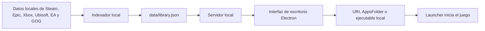

# Arquitectura

## Objetivo

Ofrecer una biblioteca y lanzador local de juegos instalados sin enviar el inventario ni datos de cuenta a servicios externos.

## Componentes

- `src/indexer.mjs`: recorre bibliotecas conocidas y genera un catálogo normalizado.
- `src/server.mjs`: expone la interfaz y una API local para leer, actualizar, lanzar títulos, guardar preferencias y configurar la tarea nocturna.
- `src/electron-main.mjs`: abre la ventana de escritorio y ejecuta la indexación programada sin mostrarla.
- `public/`: interfaz HTML, CSS y JavaScript sin dependencias externas de aplicación.
- `data/library.json`: inventario local generado; se excluye del control de versiones.
- `test/`: pruebas automáticas con `node:test` de la API y del indexador.

## Decisiones iniciales

- El servidor escucha sólo en `127.0.0.1` y rechaza solicitudes con otro origen o `Host`, para que ningún sitio web ni equipo de la red pueda modificar rutas de lanzamiento.
- Los juegos se inician con `explorer.exe` o con su ejecutable, nunca a través de `cmd.exe`.
- Las imágenes se resuelven en este orden: portada manual, imagen local del launcher (`appcache/librarycache` de Steam, logos declarados en `MicrosoftGame.config`) y, sólo para Steam, la CDN pública `cdn.cloudflare.steamstatic.com`. Las descargas se guardan en `art-cache/`; una imagen inexistente no se vuelve a pedir durante 7 días. Las rutas locales nunca se envían a la interfaz.
- El catálogo usa ID de plataforma cuando está disponible, evitando depender únicamente del nombre del juego.
- Las rutas de lanzamiento se resuelven con URI, AppsFolder o ejecutable local según la plataforma y la información encontrada.
- La fecha de última vez jugado se conserva únicamente para los inicios solicitados desde la aplicación.
- Las cuentas, compras y APIs con credenciales no se consultan en esta versión.
