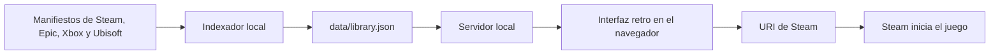

# Arquitectura

## Objetivo

Ofrecer una biblioteca y lanzador local de juegos instalados sin enviar el inventario ni datos de cuenta a servicios externos.

## Componentes

- `src/indexer.mjs`: recorre bibliotecas conocidas y genera un catálogo normalizado.
- `src/server.mjs`: expone la interfaz y una API local para leer, actualizar y lanzar títulos.
- `public/`: interfaz HTML, CSS y JavaScript sin dependencias externas de aplicación.
- `data/library.json`: inventario local generado; se excluye del control de versiones.

## Decisiones iniciales

- La aplicación se ejecuta sólo en `localhost`.
- El catálogo usa ID de plataforma cuando está disponible, evitando depender únicamente del nombre del juego.
- Steam se abre mediante su URI oficial local. Otros launchers se detectan, pero el lanzamiento directo se habilitará por plataforma en iteraciones posteriores.
- Las cuentas, compras y APIs externas no se consultan en esta versión.
