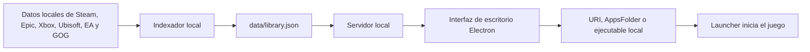

# Arquitectura

## Objetivo

Ofrecer una biblioteca y lanzador local, con conexiones opcionales a Steam e IGDB. El escaneo de instalaciones permanece local; cada integración consulta su servicio con los identificadores necesarios.

## Componentes

- `src/indexer.mjs`: recorre bibliotecas conocidas y genera un catálogo normalizado.
- `src/server.mjs`: servicios de la biblioteca (inventario, preferencias, arte, lanzamiento) y servidor local. Las rutas de la API están en `src/routes/`, una por dominio: `library.mjs` (biblioteca, jugar, instalar, imágenes), `preferences.mjs` (preferencias, respaldo, portadas, ajustes), `integrations.mjs` (Steam, IGDB, Arcade) y `system.mjs` (tarea nocturna, registro, diagnóstico, versiones nuevas).
- `src/http.mjs`: enrutador declarativo (`router.get('/api/steam/games/:appid(\d+)/:kind', …)`), lectura y validación del cuerpo y errores con código: 400 datos inválidos, 404 inexistente, 405 método no permitido, 409 falta conectar o configurar algo, 413 demasiado grande, 502 un servicio externo falló. Sólo los errores inesperados responden 500 y van al registro como error.
- `src/updates.mjs`: consulta la última publicación en GitHub (como mucho una vez por día) para avisar una versión nueva en Configuración y con un aviso al abrir.
- `src/electron-main.mjs`: abre la ventana de escritorio y ejecuta la indexación programada sin mostrarla. Una sola instancia (abrir el .exe otra vez trae la ventana al frente), `sandbox`, sin navegación fuera de la interfaz (los enlaces https se abren en el navegador), sólo el permiso de pantalla completa y puerto fijo 47321 (con otro libre si está ocupado), para que la interfaz conserve lo que guarda en el navegador entre aperturas.
- `src/json-file.mjs`: lectura y escritura de los JSON del perfil. Las lecturas quedan en memoria mientras el archivo no cambie (fecha y tamaño); las escrituras son atómicas (temporal y renombre, con reintentos en Windows) y van en fila por archivo, así dos cambios seguidos nunca se pisan. `createVersionedFile` agrega versión de esquema y migraciones, con copia `nombre.vN.bak.json` antes de migrar.
- `src/log.mjs`: registro de diagnóstico en `logs/gml.log` del perfil (rota al pasar 1 MB, se conservan tres). `GET /api/diagnostics` arma el diagnóstico que exporta Configuración; `POST /api/log` recibe los errores de la interfaz (como mucho 30 por minuto).
- `src/es.mjs`: géneros, temáticas, modos y perspectivas de IGDB y categorías de MAME en español. Los datos guardan los nombres originales; la traducción se aplica al armar `/api/library`.
- `src/igdb.mjs`: integración opcional con Twitch/IGDB. Descarga fichas ampliadas y tiempos estimados, conserva las coincidencias conocidas y guarda una caché local compacta en `metadata.json` (esquema 3, sin la respuesta original de IGDB).
- `src/secrets.mjs`: cifra el secreto de Twitch con DPAPI de Windows para el usuario actual. `integrations.json` no se versiona.
- `public/`: interfaz HTML, CSS y JavaScript sin dependencias ni compilación. `index.html` carga tres scripts clásicos con lógica pura y pruebas (`catalog.js`: búsqueda, filtros, orden y duplicados; `shelves.js`: filas de Inicio; `gamepad.js`: mando y pantalla grande) y el punto de entrada `js/main.js` como módulo ES. `styles.css` ordena los estilos en capas (`@layer`) e importa una hoja por capa desde `styles/`: tokens, base, componentes, pantallas, modo sala y utilidades. Tipografías y marca en `fonts/` y `brand/` (ver [Sistema de diseño](sistema-de-diseno.md)).
- `public/js/`: la interfaz en módulos ES, uno por responsabilidad. Cada módulo exporta sus funciones y, si tiene enlaces de eventos, una función `setup()` que `main.js` llama una sola vez, después de que todos los módulos se cargaron (así ningún módulo usa a otro antes de tiempo).

| Módulo                                                | Responsabilidad                                                                            |
| ----------------------------------------------------- | ------------------------------------------------------------------------------------------ |
| `main.js`                                             | Navegación entre páginas, carga de la biblioteca, atajos globales y arranque               |
| `state.js`                                            | Estado de la interfaz y preferencias de este equipo                                        |
| `api.js`, `icons.js`, `feedback.js`                   | Pedidos a la API, íconos, avisos y errores de formulario                                   |
| `art.js`, `cards.js`                                  | Portadas, imagen principal, color ambiental; tarjetas y navegación por teclado             |
| `home.js`, `library.js`, `game-page.js`, `details.js` | Inicio, Biblioteca, página del juego y contenido de la ficha                               |
| `launch.js`, `editor.js`, `palette.js`                | Jugar, editar un juego y paleta de comandos                                                |
| `couch.js`                                            | Modo sala para TV y mando (con `styles/couch.css`)                                         |
| `settings.js`, `diagnostics.js`, `steam.js`           | Configuración, Para revisar y todo lo de Steam                                             |
| `snapshot.js`, `report.js`                            | Arranque instantáneo (última biblioteca en IndexedDB) y errores de la interfaz al registro |

`npm run check` comprueba la sintaxis de todo `src/` y de los scripts de la interfaz (`tools/check-syntax.mjs`), que cada `import` exista en su módulo de origen (`tools/check-modules.mjs`) y las reglas de los estilos (`tools/check-styles.mjs`). `window.GML` expone el estado y la navegación para depurar desde la consola.

- `src/mame.mjs`: Arcade. Lee `-listxml` en flujo, verifica sets por CRC, aplica filtros y agrupa versiones (funciones puras con pruebas en `test/mame.test.mjs`); `createArcade` orquesta la indexación en segundo plano, el arte y el lanzamiento con medición de la sesión. Rutas: `GET/PUT /api/integrations/mame`, `POST /api/mame/scan`. Los juegos llegan a `/api/library` con `platform: 'Arcade'`, `key: 'arcade:<set>'`, `launch.type: 'mame'` y un objeto `arcade` (fabricante, jugadores, controles, orientación, saga, ranking, versiones).
- `src/wiki.mjs`: Wikipedia en inglés → Wikidata (videojuego, año, IGDB P5794, artículo en español) → introducción en español. Rutas de datos: `arcade-info.json`.
- `src/mame-commands.mjs`: lee `command.dat` y convierte sus códigos en flechas y botones legibles. `GET /api/arcade/:set/commands`.
- `src/zip-index.mjs`: lee el directorio central de un `.zip` (nombre, tamaño, CRC) sin descomprimir.
- `src/steam-assets.mjs`: rutas vigentes del arte de la tienda de Steam (servicio GetItems), con caché en `steam-assets.json`.
- `src/names.mjs`: nombres para mostrar sin sufijos de tienda. El servidor entrega `name` limpio y conserva `originalName`.
- `GET /api/art/wordmark/:key`: logo transparente del juego, desde la caché de Steam o su CDN.
- `GET/PUT /api/settings`: tema y `minimizeOnLaunch`. Al lanzar un juego con esa opción activa, el servidor avisa a Electron (`onLaunch`) para minimizar la ventana.
- `tools/package.mjs`: empaquetado que deja sólo los dos últimos ejecutables en `releases/`.
- `data/library.json`: inventario local generado; se excluye del control de versiones.
- `test/`: pruebas automáticas con `node:test` de la API, los módulos y las herramientas.
- `test/ui/`: pruebas de interfaz con Playwright sobre una biblioteca inventada (`fixture.mjs`, sin imágenes ni datos reales y sin descargas: `GML_OFFLINE=1`). Pantallas, flujos (buscar, favoritos, paleta, modo sala, arranque instantáneo, diagnóstico, aviso de versión), accesibilidad WCAG 2.1 AA con axe en ambos temas y capturas de referencia en `test/ui/capturas/`.
- `tools/ci/`: flujos de GitHub Actions, para copiar a `.github/workflows/` (ver `tools/ci/LEEME.md`): integración continua (`ci.yml`: pruebas en Windows, interfaz en Linux y portable como artefacto) y publicación al subir una etiqueta (`release.yml`).

## Datos del perfil

| Archivo                        | Versión            | Contenido                                                      |
| ------------------------------ | ------------------ | -------------------------------------------------------------- |
| `preferences.json`             | `schemaVersion: 1` | Favoritos, etiquetas, notas, progreso, tiempo jugado y ajustes |
| `metadata.json`                | `schemaVersion: 3` | Fichas de IGDB, compactas                                      |
| `library.json`                 | `schema: 2`        | Inventario de la última búsqueda (se regenera)                 |
| `arcade-*.json`, `mame-*.json` | `schema` propio    | Índice de Arcade (se regenera)                                 |
| `logs/gml.log`                 | —                  | Registro de diagnóstico                                        |

El servidor calcula `/api/library` una vez por versión de sus entradas: si ningún archivo cambió, reutiliza el resultado (y su JSON). La interfaz guarda la última biblioteca en IndexedDB y la pinta al abrir mientras pide la actual (`public/js/snapshot.js`).

La interfaz se sirve con una política de contenido estricta: sólo sus scripts, conexiones sólo a este servidor e imágenes por https.

## Decisiones iniciales

- El servidor escucha sólo en `127.0.0.1` y rechaza solicitudes con otro origen o `Host`, para que ningún sitio web ni equipo de la red pueda modificar rutas de lanzamiento.
- Los juegos se inician con `explorer.exe` o con su ejecutable, nunca a través de `cmd.exe`.
- Las imágenes se resuelven en este orden: portada manual, imagen local del launcher (`appcache/librarycache` de Steam, logos declarados en `MicrosoftGame.config`) y, sólo para Steam, la CDN pública `cdn.cloudflare.steamstatic.com`. Las descargas se guardan en `art-cache/`; una imagen inexistente no se vuelve a pedir durante 7 días. Las rutas locales nunca se envían a la interfaz.
- El catálogo usa ID de plataforma cuando está disponible, evitando depender únicamente del nombre del juego.
- Las rutas de lanzamiento se resuelven con URI, AppsFolder o ejecutable local según la plataforma y la información encontrada.
- La fecha de última vez jugado se conserva únicamente para los inicios solicitados desde la aplicación.
- IGDB requiere una aplicación de Twitch y conexión explícita desde Configuración. Sólo se envían nombres e identificadores de juegos. Steam consulta la biblioteca de la cuenta conectada mediante su integración opcional.
- La ficha presenta información disponible en secciones desplegables. La historia permanece plegada por posibles spoilers. Las duraciones son estimaciones de IGDB (segundos convertidos a horas); los idiomas y modos pueden variar entre ediciones y plataformas.
- Las capturas e ilustraciones se cargan de forma diferida desde la CDN de IGDB en la pestaña Multimedia y se amplían en un diálogo nativo con navegación por teclado; los videos y enlaces se abren externamente. La información textual descargada permanece disponible sin conexión; las imágenes pueden requerir internet.

## Steam desde 0.14.0

`src/steam.mjs` ejecuta el MCP incluido como proceso hijo con el runtime de Electron y `ELECTRON_RUN_AS_NODE`. Las credenciales sólo viajan en el entorno del proceso; nunca en argumentos o diagnósticos. Las claves usan DPAPI en un archivo separado de IGDB.

Biblioteca y logros completos usan APIs oficiales para evitar recortes del MCP. Cuenta, inventario local y preferencias permanecen separados; `mergeSteamLibrary` cruza Steam por App ID. Las respuestas incompletas no sustituyen la cuenta guardada. Cada consulta tiene caché por cuenta, argumentos y región; las fallas de red mantienen datos anteriores con aviso. Un resultado explícito de privacidad reemplaza la caché de esa consulta.

La fecha de Steam se muestra separada de la última apertura desde el launcher. Desconectar elimina credenciales y oculta la cuenta; las cachés permanecen locales. Los DLC publicados no se consideran poseídos. Las consultas sociales son de lectura y pueden devolver resultados parciales.
