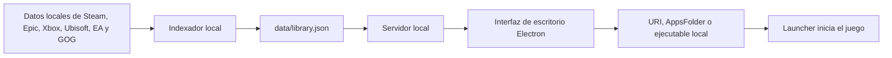

# Arquitectura

## Objetivo

Ofrecer una biblioteca y lanzador local, con conexiones opcionales a Steam e IGDB. El escaneo de instalaciones permanece local; cada integración consulta su servicio con los identificadores necesarios.

## Componentes

- `src/indexer.mjs`: recorre bibliotecas conocidas y genera un catálogo normalizado.
- `src/server.mjs`: expone la interfaz y una API local para leer, actualizar, lanzar títulos, guardar preferencias y configurar la tarea nocturna.
- `src/electron-main.mjs`: abre la ventana de escritorio y ejecuta la indexación programada sin mostrarla.
- `src/igdb.mjs`: integración opcional con Twitch/IGDB. Descarga fichas ampliadas y tiempos estimados, conserva las coincidencias conocidas y guarda una caché local en `metadata.json` (esquema 2). Cada ficha incluye la respuesta original en `source`; la API local omite ese campo para evitar duplicar el contenido enviado a la interfaz.
- `src/secrets.mjs`: cifra el secreto de Twitch con DPAPI de Windows para el usuario actual. `integrations.json` no se versiona.
- `public/`: interfaz HTML, CSS y JavaScript sin dependencias externas de aplicación. `style.css` define tokens y temas; `ui.css`, los componentes; `experience.css`, la identidad 3.0 (barra lateral, color ambiental, Inicio y página de juego); `shelves.js`, las reglas que eligen los juegos de Inicio; `catalog.js`, la búsqueda, los filtros, el orden y la agrupación de duplicados de la Biblioteca; `gamepad.js`, el mando y la pantalla grande. Las tipografías y la marca están en `fonts/` y `brand/` (ver [Sistema de diseño](sistema-de-diseno.md)).
- `src/mame.mjs`: Arcade. Lee `-listxml` en flujo, verifica sets por CRC, aplica filtros y agrupa versiones (funciones puras con pruebas en `test/mame.test.mjs`); `createArcade` orquesta la indexación en segundo plano, el arte y el lanzamiento con medición de la sesión. Rutas: `GET/PUT /api/integrations/mame`, `POST /api/mame/scan`. Los juegos llegan a `/api/library` con `platform: 'Arcade'`, `key: 'arcade:<set>'`, `launch.type: 'mame'` y un objeto `arcade` (fabricante, jugadores, controles, orientación, saga, ranking, versiones).
- `src/zip-index.mjs`: lee el directorio central de un `.zip` (nombre, tamaño, CRC) sin descomprimir.
- `src/steam-assets.mjs`: rutas vigentes del arte de la tienda de Steam (servicio GetItems), con caché en `steam-assets.json`.
- `src/names.mjs`: nombres para mostrar sin sufijos de tienda. El servidor entrega `name` limpio y conserva `originalName`.
- `GET /api/art/wordmark/:key`: logo transparente del juego, desde la caché de Steam o su CDN.
- `GET/PUT /api/settings`: tema y `minimizeOnLaunch`. Al lanzar un juego con esa opción activa, el servidor avisa a Electron (`onLaunch`) para minimizar la ventana.
- `tools/package.mjs`: empaquetado que deja sólo los dos últimos ejecutables en `releases/`.
- `data/library.json`: inventario local generado; se excluye del control de versiones.
- `test/`: pruebas automáticas con `node:test` de la API y del indexador.

## Decisiones iniciales

- El servidor escucha sólo en `127.0.0.1` y rechaza solicitudes con otro origen o `Host`, para que ningún sitio web ni equipo de la red pueda modificar rutas de lanzamiento.
- Los juegos se inician con `explorer.exe` o con su ejecutable, nunca a través de `cmd.exe`.
- Las imágenes se resuelven en este orden: portada manual, imagen local del launcher (`appcache/librarycache` de Steam, logos declarados en `MicrosoftGame.config`) y, sólo para Steam, la CDN pública `cdn.cloudflare.steamstatic.com`. Las descargas se guardan en `art-cache/`; una imagen inexistente no se vuelve a pedir durante 7 días. Las rutas locales nunca se envían a la interfaz.
- El catálogo usa ID de plataforma cuando está disponible, evitando depender únicamente del nombre del juego.
- Las rutas de lanzamiento se resuelven con URI, AppsFolder o ejecutable local según la plataforma y la información encontrada.
- La fecha de última vez jugado se conserva únicamente para los inicios solicitados desde la aplicación.
- IGDB requiere una aplicación de Twitch y conexión explícita desde Configuración. Sólo se envían nombres e identificadores de juegos. Steam consulta la biblioteca de la cuenta conectada mediante su integración opcional.
- La ficha presenta información disponible en secciones desplegables. La historia permanece plegada por posibles spoilers. Las duraciones son estimaciones de IGDB (segundos convertidos a horas); los idiomas y modos pueden variar entre ediciones y plataformas.
- Las capturas e ilustraciones se cargan de forma diferida desde la CDN de IGDB en la pestaña Multimedia y se amplían en un diálogo nativo con navegación por teclado; los videos y enlaces se abren externamente. La información textual descargada permanece disponible sin conexión; las imágenes pueden requerir internet.

## Steam desde 0.14.0

`src/steam.mjs` ejecuta el MCP incluido como proceso hijo con el runtime de Electron y `ELECTRON_RUN_AS_NODE`. Las credenciales sólo viajan en el entorno del proceso; nunca en argumentos o diagnósticos. Las claves usan DPAPI en un archivo separado de IGDB.

Biblioteca y logros completos usan APIs oficiales para evitar recortes del MCP. Cuenta, inventario local y preferencias permanecen separados; `mergeSteamLibrary` cruza Steam por App ID. Las respuestas incompletas no sustituyen la cuenta guardada. Cada consulta tiene caché por cuenta, argumentos y región; las fallas de red mantienen datos anteriores con aviso. Un resultado explícito de privacidad reemplaza la caché de esa consulta.

La fecha de Steam se muestra separada de la última apertura desde el launcher. Desconectar elimina credenciales y oculta la cuenta; las cachés permanecen locales. Los DLC publicados no se consideran poseídos. Las consultas sociales son de lectura y pueden devolver resultados parciales.
