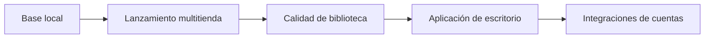

# Plan de trabajo

Este plan organiza el proyecto por entregables verificables. No fija fechas rígidas: cada etapa termina cuando se cumplen sus criterios de aceptación.

## Estado actual — implementación hasta 0.5 terminada

La base local está terminada:

- Repositorio Git inicializado y primer commit creado.
- Inventario local de Steam, Epic Games, Xbox/Microsoft Store y Ubisoft.
- Interfaz híbrida: cabecera retro y controles de aplicación de escritorio.
- Actualización manual y tarea diaria a las 03:00.
- Vistas Explorador, Detalle, Lista e Iconos grandes.
- Favoritos, etiquetas y últimos lanzamientos locales.
- Portadas locales, progreso, puntuación, notas y rutas de lanzamiento manuales.
- Respaldo e importación de preferencias personales.
- Aplicación de escritorio Electron y ejecutable portable de Windows.
- Rutas de lanzamiento implementadas para Steam, Epic, Ubisoft y Xbox/Microsoft Store cuando sus datos locales permiten resolverlas.

La implementación está completa, pero la validación real de cada launcher sigue pendiente. Se evitó abrir juegos durante las pruebas automáticas.

## Ahora — validación de las versiones 0.3 a 0.5

| Iniciativa | Resultado | Criterio de aceptación |
| --- | --- | --- |
| Validar lanzadores | Confirmar las rutas de inicio de Steam, Epic, Ubisoft y Xbox/Microsoft Store. | Se inicia al menos un juego de cada plataforma compatible desde la biblioteca. |
| Validar vistas y filtros | Comprobar los cuatro modos de presentación, búsquedas y filtros combinados. | No aparecen errores y el mismo conjunto de juegos se refleja en todas las vistas. |
| Validar la tarea nocturna | Confirmar que la tarea se ejecuta sin abrir ventanas ni alterar preferencias. | La fecha de escaneo cambia y favoritos/etiquetas permanecen intactos. |
| Ajustar detección | Resolver los juegos marcados como “Requiere revisión”. | Cada caso muestra una explicación correcta o queda excluido por decisión explícita. |
| Validar escritorio | Abrir la aplicación portable y confirmar que conserva los datos entre ejecuciones. | Se abre sin navegador ni terminal y los cambios personales persisten. |
| Validar personalización | Cargar una portada, editar la ficha y restaurar un respaldo. | Todos los datos se muestran tras reindexar o reiniciar. |

## Siguiente — versión 0.6: configuración y diagnóstico

| Iniciativa | Dependencia | Criterio de aceptación |
| --- | --- | --- |
| Configuración de indexación | Gestionar desde la interfaz la hora y el estado de la tarea nocturna. | No hace falta editar scripts para los ajustes habituales. |
| Diagnóstico de launcher | Explicar rutas incompletas y ofrecer acciones de corrección. | Cada problema tiene una causa y una siguiente acción visible. |

## Más adelante — versión 1.0: bibliotecas compradas

Las integraciones con cuentas externas quedan deliberadamente fuera de las versiones iniciales. Se abordarán después de que el lanzamiento local sea confiable.

- Conectar cada plataforma mediante el método oficial que esté disponible.
- Mostrar “en biblioteca”, “instalado” y “no instalado” como estados independientes.
- Solicitar autorización explícita para cada cuenta y guardar sus credenciales de forma segura en el equipo.

## Prioridad y límites de alcance

La prioridad es: **detectar correctamente → lanzar correctamente → mejorar la biblioteca → conectar cuentas**. No se avanzará con APIs de cuentas antes de terminar los lanzadores locales.

Para mantener el ritmo, cada ciclo reservará aproximadamente 70% para funciones visibles, 20% para estabilidad y 10% para correcciones o mejoras pequeñas.

## Revisión del plan

Revisar este documento después de completar cada versión menor (`0.1`, `0.2`, `0.3`). Si aparece una nueva idea, se agrega al final como candidata y sólo sube de prioridad si reemplaza una tarea ya planificada.
