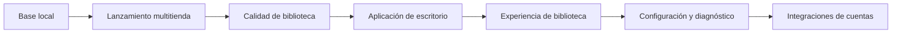

# Plan de trabajo

Este plan organiza el proyecto por entregables verificables. No fija fechas rígidas: cada etapa termina cuando se cumplen sus criterios de aceptación.

## Estado actual — implementación hasta 0.14.2 terminada

La base local está terminada:

- Repositorio Git inicializado y primer commit creado.
- Inventario local de Steam, Epic Games, Xbox/Microsoft Store y Ubisoft.
- Interfaz híbrida: cabecera retro y controles de aplicación de escritorio.
- Actualización manual y tarea diaria a las 03:00.
- Vistas Portadas, Lista, Ficha y Tabla, con un propósito diferenciado para descubrir, escanear, profundizar y comparar.
- Favoritos, etiquetas y últimos lanzamientos locales.
- Portadas locales, progreso, puntuación, notas y rutas de lanzamiento manuales.
- Respaldo e importación de preferencias personales.
- Aplicación de escritorio Electron y ejecutable portable de Windows.
- Primera apertura corregida: la aplicación crea su inventario local antes de mostrar la biblioteca.
- Navegación en Inicio, Biblioteca, Diagnóstico y Configuración.
- Sistema visual de escritorio con estados de carga, vacío, error y confirmación.
- Diagnóstico por plataforma y horario de indexación nocturna configurable desde la aplicación.
- Fecha de última vez jugado registrada al iniciar un título desde Games Meta Launcher.
- Explorador en tabla única, ordenable de forma ascendente o descendente por nombre, plataforma, unidad, estado y fecha de juego.
- Servidor local restringido a esta PC, respaldos validados y lanzamiento sin `cmd.exe` (0.7.2 y 0.8.0).
- Pruebas automáticas (`npm test`) y código fuente formateado.
- Rutas de lanzamiento implementadas para Steam, Epic, Ubisoft y Xbox/Microsoft Store; validadas manualmente en 0.8.1.
- Portadas desde los datos locales de cada launcher, con descarga desde la CDN de Steam cuando faltan (0.9.0).
- Interfaz 2.0 accesible, modo oscuro e integración beta con IGDB (0.10.0).
- Paleta de comandos, avisos con Deshacer y errores junto a cada campo (0.11.0).

Autenticación y consultas reales de IGDB validadas el 23 de octubre de 2026. Las fichas ampliadas se descargaron para los 50 juegos locales (0.12.0). La ficha usa pestañas y un visor de imágenes integrado desde 0.13.0. Steam enriquece la misma colección con la biblioteca de cuenta, instalada o no, desde 0.14.0; no agrega un destino propio de navegación. Queda pendiente revisar manualmente la exactitud de cada coincidencia de IGDB antes de retirar la etiqueta beta.

## Validaciones funcionales de base

| Iniciativa | Resultado | Criterio de aceptación |
| --- | --- | --- |
| Validar lanzadores | Confirmar las rutas de inicio de Steam, Epic, Ubisoft y Xbox/Microsoft Store. | Se inicia al menos un juego de cada plataforma compatible desde la biblioteca. |
| Validar vistas y filtros | Comprobar los cuatro modos de presentación, búsquedas y filtros combinados. | No aparecen errores y el mismo conjunto de juegos se refleja en todas las vistas. |
| Validar la tarea nocturna | Confirmar que la tarea se ejecuta sin abrir ventanas ni alterar preferencias. | La fecha de escaneo cambia y favoritos/etiquetas permanecen intactos. |
| Ajustar detección | Resolver los juegos marcados como “Requiere revisión”. | Cada caso muestra una explicación correcta o queda excluido por decisión explícita. |
| Validar escritorio | Abrir la aplicación portable y confirmar que conserva los datos entre ejecuciones. | Se abre sin navegador ni terminal y los cambios personales persisten. |
| Validar personalización | Cargar una portada, editar la ficha y restaurar un respaldo. | Todos los datos se muestran tras reindexar o reiniciar. |

## Versiones 0.6, 0.7 y 0.7.1 — completadas

| Iniciativa | Dependencia | Criterio de aceptación |
| --- | --- | --- |
| Experiencia de biblioteca | Navegación lateral, inicio con accesos rápidos, filtros reorganizados y cuatro vistas refinadas. | Disponible. |
| Estados e interacción | Retroalimentación de éxito, biblioteca vacía, mensajes claros y atajos de teclado. | Disponible. |
| Diagnóstico y horario | Panel de salud por plataforma y configuración visual de indexación nocturna. | Disponible. |
| Fecha de juego y Explorador | Registro local del último inicio y tabla de Explorador ordenable. | Disponible. |

## Siguiente — validación de coincidencias de IGDB

| Iniciativa | Dependencia | Criterio de aceptación |
| --- | --- | --- |
| Validar coincidencias de IGDB | Credenciales y conexión ya verificadas; revisar las fichas descargadas. | Los juegos de cada plataforma muestran la ficha correcta; se quita la etiqueta beta. |
| Ajustar detección | Corregir juegos en revisión a partir de los diagnósticos. Tiny Lands (Epic) ya explica que su carpeta no existe. | Cada caso se resuelve o explica de forma útil. |
| Pulido de UX | Incorporar correcciones surgidas del uso real. | La interfaz mantiene claridad y coherencia en los flujos frecuentes. |

## Más adelante — versión 1.0: bibliotecas compradas

Las integraciones con cuentas externas quedan deliberadamente fuera de las versiones iniciales. Se abordarán después de que el lanzamiento local sea confiable.

- Conectar cada plataforma mediante el método oficial que esté disponible.
- Mostrar “en biblioteca”, “instalado” y “no instalado” como estados independientes.
- Solicitar autorización explícita para cada cuenta y guardar sus credenciales de forma segura en el equipo.

## Prioridad y límites de alcance

La prioridad es: **detectar correctamente → lanzar correctamente → mejorar la biblioteca → conectar cuentas**. No se avanzará con APIs de cuentas antes de terminar los lanzadores locales.

Para mantener el ritmo, cada ciclo reservará aproximadamente 70% para funciones visibles, 20% para estabilidad y 10% para correcciones o mejoras pequeñas.

## Revisión del plan

Revisar este documento después de completar cada versión menor. Si aparece una nueva idea, se agrega al final como candidata y sólo sube de prioridad si reemplaza una tarea ya planificada.

Steam 0.14.0: integración completa del [plan aprobado](plan-integracion-steam.md), con 34 pruebas automáticas y verificación real de 266 juegos de cuenta. IGDB actualizado para los 279 juegos de la colección combinada; las coincidencias siguen en beta y requieren revisión editorial. En 0.14.2, Inicio pasó a sintetizar la colección y las cuatro vistas de Biblioteca se delimitaron para evitar redundancias.
