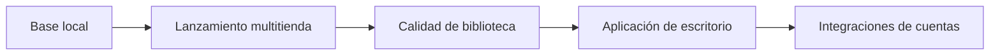

# Plan de trabajo

Este plan organiza el proyecto por entregables verificables. No fija fechas rígidas: cada etapa termina cuando se cumplen sus criterios de aceptación.

## Estado actual

La base local está terminada:

- Repositorio Git inicializado y primer commit creado.
- Inventario local de Steam, Epic Games, Xbox/Microsoft Store y Ubisoft.
- Interfaz retro con búsqueda, filtros por plataforma y unidad, y ordenamiento.
- Actualización manual y tarea diaria a las 03:00.
- Lanzamiento de títulos de Steam mediante URI local.

## Ahora — consolidar la versión 0.1

| Iniciativa | Resultado | Criterio de aceptación |
| --- | --- | --- |
| Robustecer el indexador | El inventario detecta bibliotecas Steam configuradas y evita rutas fijas cuando sea posible. | Se vuelven a indexar las bibliotecas conocidas sin duplicados ni juegos ausentes por cambios de unidad. |
| Clasificar el catálogo | Cada tarjeta indica claramente si está instalado, pendiente o es una referencia residual. | Los filtros de estado devuelven resultados correctos. |
| Mejorar la experiencia visual | Las tarjetas incorporan arte local o íconos por plataforma y estados claros de carga/error. | La interfaz sigue siendo legible en pantalla chica y escritorio. |
| Pruebas de uso | Verificar escaneo manual, escaneo automático y lanzamiento de Steam. | Las tres acciones terminan sin error y el catálogo conserva 50 juegos detectados. |

## Siguiente — versión 0.2: lanzar desde una sola biblioteca

| Iniciativa | Dependencia | Criterio de aceptación |
| --- | --- | --- |
| Epic Games | Detectar ejecutable o URI fiable por manifiesto. | Un juego Epic instalado se abre desde su tarjeta. |
| Ubisoft Connect | Obtener el identificador de lanzamiento desde sus metadatos locales. | Anno 1800 se abre desde la interfaz. |
| Xbox/Microsoft Store | Resolver el identificador `AppsFolder` de cada paquete. | Un título de Game Pass/Microsoft Store se abre desde la interfaz. |
| EA app y GOG | Incorporar detectores de instalación. | La interfaz muestra esos juegos y deja claro si se pueden iniciar. |
| Favoritos y recientes | Modelo de preferencias local. | Se pueden marcar favoritos y ver los últimos lanzados. |

## Después — versión 0.3: convertir el inventario en biblioteca personal

| Iniciativa | Valor | Criterio de aceptación |
| --- | --- | --- |
| Carátulas y metadatos | Biblioteca más reconocible y agradable de recorrer. | Cada juego tiene portada o un diseño alternativo consistente. |
| Etiquetas personales | Filtros por género, completado, pendiente y favoritos. | Las etiquetas se editan localmente y sobreviven una reindexación. |
| Diagnóstico de instalaciones | Distinguir juego incompleto, movido o no disponible. | Los casos dudosos se muestran con una explicación y nunca se lanzan por error. |
| Empaquetado para Windows | Abrir la app sin una terminal visible. | Se instala o ejecuta como aplicación de Escritorio mediante el acceso directo. |

## Más adelante — versión 1.0: bibliotecas compradas

Las integraciones con cuentas externas quedan deliberadamente fuera de las versiones iniciales. Se abordarán después de que el lanzamiento local sea confiable.

- Conectar cada plataforma mediante el método oficial que esté disponible.
- Mostrar “en biblioteca”, “instalado” y “no instalado” como estados independientes.
- Solicitar autorización explícita para cada cuenta y guardar sus credenciales de forma segura en el equipo.

## Prioridad y límites de alcance

La prioridad es: **detectar correctamente → lanzar correctamente → mejorar la biblioteca → conectar cuentas**. No se avanzará con APIs de cuentas antes de terminar los lanzadores locales.

Para mantener el ritmo, cada ciclo reservará aproximadamente 70% para funciones visibles, 20% para estabilidad y 10% para correcciones o mejoras pequeñas.

## Revisión del plan

Revisar este documento después de completar cada versión menor (`0.1`, `0.2`, `0.3`). Si aparece una nueva idea, se agrega al final como candidata y sólo sube de prioridad si reemplaza una tarea ya planificada.
